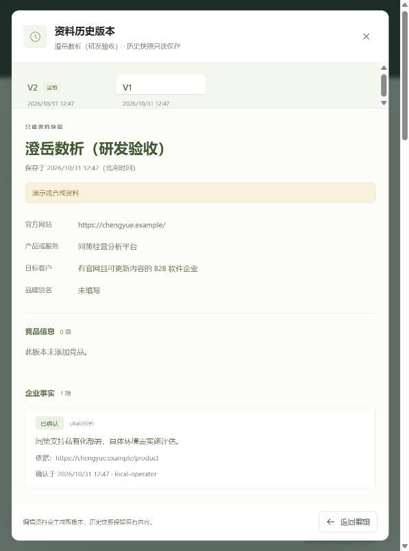

# #1 品牌资料与企业事实管理验收

日期：2026-10-31。结论：本机工程验收通过。所有验收资料明确标记为合成，未接入真实消费端或付费模型。

## 环境与检查

- Node.js 24.9.0，Next.js 16.4.3，React 19.3.1，PostgreSQL 17.11，Drizzle 0.45.4。
- Docker Desktop 的本机 WSL 引擎未就绪，使用运行脚本提供的真实 Windows PostgreSQL，地址为 `127.0.0.1:55432`，持久数据与随机凭证均被 Git 忽略。
- `npm run db:migrate`：通过，创建工作区、项目和不可变版本表。
- `npm run typecheck`、`npm run lint`、`npm run build`：通过。
- `npm run test:regression`：三个用例通过，仅针对实测发现的同源校验 bug；验证内部主机名不同的正常请求可以保存、跨站及伪造转发头不能绕过检查、异常 Origin 被拒绝。
- `npm run start`：实际仅监听 `127.0.0.1:3000`，浏览器使用同一生产构建完成操作。

## 逐项验收

| #1 要求 | 实际证据 |
|---|---|
| 可运行初始化与指定技术栈 | 已锁定依赖、建立迁移、真实数据库连接并通过构建；未用内存或文件替代 PostgreSQL。 |
| 创建、编辑和重新打开项目 | 浏览器新建“澄岳数析（研发验收）”，保存 V1，再编辑保存 V2，刷新后重新取得 V2。 |
| 最多三个竞品、明确输入错误 | 浏览器添加到三项后按钮禁用；直接提交第四项返回 HTTP 400。 |
| 已确认事实与待补资料分开 | V2 包含一项有来源的已确认事实及一项待确认事实；缺少来源却请求确认返回 HTTP 400。 |
| 历史版本与工作区归属 | 浏览器历史弹窗可看到 V1 原始产品说明、零竞品及一条事实；V2 为新说明、三竞品及两条事实；服务端仓储按工作区查询，客户端提交工作区字段返回 HTTP 400。 |
| 乐观锁及失败不能改写数据 | 过期 `expectedVersion=1` 更新返回 HTTP 409；拒绝请求后项目仍为 V2，两份快照保持不变。 |
| 本地访问及来源检查 | 浏览器正常保存已通过；外站 Origin 返回 HTTP 403；不信任转发头替代目标主机。 |
| 启动说明与范围记录 | 本地数据库、依赖、迁移、启动与停止步骤见开发说明；本页记录已验证范围。 |

## 浏览器证据

## 边界

本次证明本地品牌资料持久化、版本、输入校验及界面流程。邀请登录与跨账号隔离、采样、分析、页面抓取、修改核验和效果观察属于后续任务，未借用本次验收宣称完成。合成资料中的 `.example` 网站未发起网络抓取。
